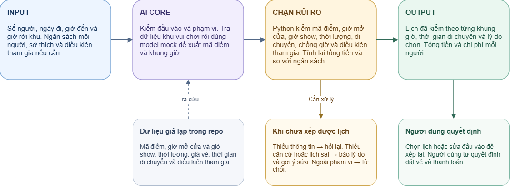

# AI SPEC — Lập lịch một ngày ở khu vui chơi · Nhóm K5-L3A-4MEMS · Phòng [XXX] · Zone [X]

> Mốc nộp: §7 chốt chuẩn "đạt" tại **CP2 19:30 Thứ Sáu 27/11** · §0–§7 nộp **CP3 10:00 Thứ Bảy 28/11** · đủ §0–§10 **CP4 14:30 Thứ Bảy 28/11** · §10 changelog ghi tiếp đến **23:59 Thứ Bảy 28/11**.
> Đầu mỗi mục ghi bước guide (`02-guide.md` trong repo đề) chỉ cách điền. Mỗi mục ngắn, có số và nguồn; chi tiết để ở file được trỏ tới. Xoá dòng hướng dẫn trong ngoặc vuông khi điền xong.

Track C · Du lịch · Hướng C1 — Lập lịch một ngày ở một khu vui chơi.
Data BTC cấp đã dùng (nếu có — không commit nguyên file): __

## §0. Hiện tại việc này diễn ra thế nào *(guide 1.1)*
- Luồng hiện tại của việc này, trong khoá hoặc trên app thật (3–5 bước; ảnh chụp từ tài khoản của mình, đã che thông tin):
- Công cụ / AI đang được dùng cho việc này (nếu có) + nguồn. Không kiểm được thì ghi "chưa kiểm":

## §1. Người dùng & bằng chứng *(guide 1.1, 1.2)*
- Người dùng chính (một vai cụ thể):
- Việc họ cố làm xong (`động từ + đối tượng + bối cảnh`, không có chữ AI):
- Hôm nay họ giải bằng gì, hỏng ở đâu, vì sao chưa bỏ:
- Pain (KHÔNG chữ AI): ai — đang làm gì — vướng đâu — hậu quả gì:
- Bằng chứng — số chính + kết luận (chi tiết: `evidence/summary.md`): __

## §2. Impact & quyết định chọn *(guide 1.3)*

| Hướng | Bao nhiêu người gặp | Bao nhiêu lần / tháng | Mỗi lần tốn gì | Impact / tháng | Làm kịp không | Chọn? |
|---|---|---|---|---|---|---|
|  |  |  |  |  |  |  |
|  |  |  |  |  |  |  |
|  |  |  |  |  |  |  |

- **Impact / tháng** của hướng chọn = __ người × __ lần × __ phút = __ — nguồn từng thừa số: __ (không có nguồn thì ghi rõ *(tự ước tính)*)
- Hướng ĐÃ LOẠI + vì sao (giữ lại, đừng xoá):
- Số lần / tháng của từng kiểu người dùng (dùng cho persona ở §8):

## §3. Giải pháp tương tự *(guide 2.1)*
- **Disney Genie trong My Disney Experience** gợi ý lịch và hoạt động theo sở thích của nhóm, rồi gom kế hoạch trong mục My Plans. [Disney Genie — Walt Disney World](https://disneyworld.disney.go.com/experience-updates/genie/)
- **Học** cách hỏi nhóm muốn chơi gì trước khi xếp thứ tự. **Tránh** yêu cầu đăng nhập hay có vé chỉ để thử xếp lịch, vì trưởng nhóm cần xem trước tổng chi phí. **Thiết kế của nhóm** kiểm ngân sách bằng Python và nêu khoản chi hoặc ràng buộc cụ thể khiến lịch chưa khả thi.

## §4. Thiết kế *(guide 2.2, 3.2)*
- **Lát cắt dự kiến.** Trưởng nhóm bạn trẻ nhập thông tin chuyến đi để AI chọn điểm chơi và thứ tự trong một ngày tại một khu vui chơi, rồi nhận lịch theo giờ kèm tổng chi phí hoặc lý do chưa xếp được.
- **Ngoài phạm vi.** Đặt vé hoặc thanh toán, lập lịch nhiều ngày hoặc nhiều khu, tính chi phí đi lại đến khu vui chơi và dự báo thời tiết trực tiếp.
- **Sơ đồ kiến trúc.** Input → AI Core → Chặn rủi ro → Output. [Tệp XML để chỉnh sửa trong draw.io](docs/kien-truc-ai-cp2.xml)

  

- **Hình dạng.** Workflow cố định. Kiểm tra đầu vào, đọc dữ liệu, đề xuất lịch rồi kiểm bằng Python là một chuỗi có thể dự đoán và kiểm thử từng bước. Luồng dùng một lần gọi model cho mỗi đề xuất và dừng sau một lượt kiểm vì dữ liệu, thứ tự xử lý và điểm quyết định đã xác định trước.
- **Đầu vào.** Số người, ngày đi, giờ đến và giờ rời khu, ngân sách/người tính bằng VND. Sở thích có thể ghi cụ thể hoặc chọn tùy ý. Chỉ hỏi thêm điều kiện tham gia nếu điểm chơi có giới hạn cần xác minh.
- **Công cụ dự kiến để Phúc đối chiếu với `codebase/tools.py`.**

  | Công cụ | Input | Output | Tác động ra ngoài? |
  |---|---|---|---|
  | Tra dữ liệu khu vui chơi | Ngày đi, khung giờ | Mã điểm chơi, giờ hoạt động, giờ show, thời lượng, giá vé, thời gian di chuyển, điều kiện tham gia và phiên bản dữ liệu | Không · đọc dữ liệu trong repo |
  | Kiểm lịch và tính chi phí | Các mã điểm, khung giờ do model đề xuất, dữ liệu đã tra và ràng buộc của nhóm | Lịch đã kiểm, tổng tiền và chi phí/người hoặc danh sách lỗi có lý do | Không · tính toán trong Python |

- **Mức tự động.** AI gợi ý, trưởng nhóm quyết định. Lỡ show hoặc vượt ngân sách ảnh hưởng cả nhóm, nên Python kiểm ràng buộc trước khi lịch xuất hiện.
- **Chỗ chặn rủi ro.** Kiểm tra trường bắt buộc và phạm vi trước khi gọi model. Python bác mã điểm lạ và kiểm giờ mở cửa, giờ show, thời lượng, di chuyển, chồng giờ, điều kiện tham gia và ngân sách từ dữ liệu nguồn. Tổng chi phí được tính từ vé vào cửa và phí của các hoạt động đã xếp. Nếu yêu cầu phụ thuộc thời tiết hoặc dữ liệu khác chưa có căn cứ, trả lý do và gợi ý điều chỉnh yêu cầu.
- **Chỗ người duyệt.** Sau khi xem lịch và chi phí, trưởng nhóm chọn dùng lịch hoặc sửa yêu cầu để xếp lại. Các quyết định đặt vé, thanh toán và việc đi theo lịch thuộc về người dùng.
- **Nguyên tắc thiết kế**

  | Nguyên tắc | Chỗ cụ thể trên sơ đồ / trong bản chạy thử |
  |---|---|
  | G10 — thu hẹp phạm vi khi không chắc | Hỏi lại đúng trường bắt buộc còn thiếu. Nếu thiếu dữ liệu để kiểm ràng buộc, báo rõ và dừng trước khi xuất lịch hợp lệ. |
  | Đối chiếu với dữ liệu nguồn | Model chỉ đề xuất mã điểm và khung giờ. Python lấy giá và điều kiện từ dữ liệu đã tra để kiểm lịch. |
  | Người dùng quyết định | Đầu ra hiển thị lịch, chi phí và lý do chọn để trưởng nhóm xem và sửa. |

- **Phần mô phỏng CP2.** Dự kiến dùng model mock và dữ liệu của một khu vui chơi giả lập. Lịch, giá và giờ show ở demo đều là dữ liệu minh họa. Phúc cập nhật công cụ thực tế và phiên bản dữ liệu khi tích hợp.

## §5. Chỗ khó — 4 lớp + ≥6 kịch bản + 2 tấn công *(guide 2.3)*

| Kịch bản | Lớp (1–4) | Hành vi mong muốn (nói gì, hiện gì, cho làm gì tiếp) | Câu thử |
|---|---|---|---|
|  |  |  |  |
| *(tấn công)* |  |  |  |
| *(tấn công)* |  |  |  |

(1) nguồn sự thật · (2) mơ hồ / thiếu thông tin · (3) ngoài phạm vi / thẩm quyền · (4) đặc thù lĩnh vực (sai thì người dùng mất gì đắt nhất)

## §6. Bốn đường đi của trải nghiệm
- **Mọi thứ suôn sẻ.** Trưởng nhóm nhập đủ thông tin. Lịch qua bước kiểm được hiển thị theo giờ, gồm điểm chơi, thời gian di chuyển, lý do chọn, tổng chi phí và chi phí/người.
- **Không chắc, thiếu thông tin (lớp 2).** Nếu thiếu ngân sách, hỏi “Ngân sách vé và hoạt động tối đa cho mỗi người là bao nhiêu?” Chờ người dùng bổ sung rồi mới xếp lịch.
- **Không có căn cứ (lớp 1).** Nếu thiếu giờ của show người dùng muốn xem, báo rõ show nào chưa có giờ trong dữ liệu và mời người dùng bỏ ràng buộc phải xem show đó.
- **Người dùng sửa.** Trưởng nhóm đổi giờ về hoặc bỏ một điểm chơi. Hệ thống xếp lại, kiểm toàn bộ ràng buộc và tính lại chi phí theo yêu cầu mới.
- **Ngoài phạm vi (lớp 3).** Nếu được nhờ đặt vé, giải thích phạm vi lập lịch và gợi ý trưởng nhóm kiểm vé trên kênh chính thức của khu vui chơi.
- **Đặc thù khu vui chơi (lớp 4).** Nếu hai suất show bị chồng giờ, hoặc một trò có điều kiện tham gia chưa xác minh được, báo ràng buộc vướng và cho trưởng nhóm chọn hoạt động khác hoặc cung cấp thông tin cần thiết.

## §7. Đánh giá & chuẩn "đạt" *(guide 2.4, 4.1)*
- Data card `data/DATA_CARD.md` · bộ câu thử CP2 `eval/benchmark.csv` — 12 câu (4 `thuong` · 6 `kho` · 2 `tu_choi`) · `eval/metric_spec.yaml` — 4 metric.
- **Chuẩn "đạt" chốt tại CP2.** Lượt đánh giá đạt khi ít nhất 80% tổng số câu qua tiêu chí từng câu và cả bốn metric đều đạt ngưỡng trong `eval/metric_spec.yaml`.
- Với bộ câu CP2, ngưỡng tổng yêu cầu ít nhất **10/12 câu đạt** và metric từ chối yêu cầu **2/2 câu `tu_choi` đạt**. Khóa chuẩn từ **19:30 Thứ Sáu 27/11** đến **23:59 Thứ Bảy 28/11**.
- Kết quả: lượt 1 __/__ (__%) · lượt 2 __/__ (__%) — run ID: __ / __ → chi tiết `eval/report.md`, hồ sơ `eval/README.md`

## §8. Chi phí khi dùng thật *(guide 4.2)*
- Persona + giá: `cost/personas.yaml` · lượt mô phỏng: `cost/simulate-__.csv` (__ phiên)
- Chi phí / task thành công: __ (model __) · __ (model __)
- Chi phí / tháng ở quy mô thật: thấp __ · cơ sở __ · cao __ → chi tiết `cost/cost-estimate.md`
- So với impact / người / tháng (§2): đáng làm không, vì sao:

## §9. Rủi ro & an toàn
- **Dữ liệu.** Thiết kế CP2 dùng dữ liệu khu vui chơi giả lập. Đầu vào chỉ cần thông tin tổng hợp của nhóm. Bỏ tên và thông tin liên hệ khỏi ví dụ từ người dùng hoặc review trước khi lưu. Khi nối API model, chỉ gửi các trường cần để lập lịch và dữ liệu điểm chơi. Họ tên, số điện thoại, vị trí chính xác, mã vé và thông tin thanh toán nằm ngoài dữ liệu thu thập.
- **Hành động bị chặn.** Đặt vé, thanh toán, gửi tin hoặc bỏ qua giờ mở cửa, giới hạn tham gia và ngân sách. Yêu cầu bỏ qua bước kiểm được xử lý như đầu vào ngoài phạm vi.
- **Ai chịu ảnh hưởng.** Cả nhóm có thể lỡ show, trả thêm tiền hoặc đến một trò không đủ điều kiện tham gia. Python đối chiếu từng mục với nguồn trước khi trả lịch. Thiếu dữ liệu để xác minh điều kiện tham gia thì loại điểm đó khỏi lịch hoặc báo chưa xếp được nếu đó là điểm bắt buộc.

## §10. Phân công & changelog
- **Giả định thiết kế CP2.** Dùng hướng C1 cho trưởng nhóm bạn trẻ như canvas CP1 trên GitHub. Nam đối chiếu bằng chứng Hà Anh bàn giao để xác nhận đối tượng khi chốt CP2. [Canvas CP1 trên GitHub](https://github.com/Namtran1203/K5-Day15-L3A-4MEMS/blob/8ce9185a2a2120448dc79d975e9dc14bfa8420fd/canvas.md)

### Phân công theo từng mục spec

| Mục | Chịu trách nhiệm | Người phối hợp và nội dung bàn giao |
|---|---|---|
| §0 · Cách làm hiện tại | Nguyễn Hà Anh | Mô tả 3–5 bước người dùng tự lập lịch, kèm ảnh đã che thông tin và nguồn cho công cụ họ đang dùng. |
| §1 · Người dùng và bằng chứng | Nguyễn Hà Anh | Ghi đối tượng, khó khăn, số liệu và kết luận có nguồn trong `evidence/summary.md`. Gửi Nam bằng chứng để chốt nhóm người dùng, gửi Hùng tình huống thật để viết câu thử. |
| §2 · Impact và quyết định chọn | Nguyễn Hà Anh | Tính impact theo tháng, ghi nguồn từng thừa số và lý do loại các hướng còn lại. Nam duyệt hướng chọn và thống nhất nhóm người dùng giữa `canvas.md` và `spec.md`. |
| §3 · Giải pháp tương tự | Trần Thành Nam | Chọn sản phẩm hoặc tính năng gần nhất, ghi nguồn, một điểm đáng học, một điểm cần tránh và điểm khác của lát cắt nhóm. |
| §4 · Thiết kế | Trần Thành Nam | Chốt lát cắt, vẽ sơ đồ, ghi phạm vi, ràng buộc và điểm người dùng duyệt. Bùi Hữu Phúc sở hữu bản chạy thử, dựng dữ liệu giả lập, viết công cụ kiểm lịch và mô tả đầu vào, đầu ra từng công cụ để Nam đối chiếu sơ đồ với code. Hai người chạy `python run.py` bằng mock ở CP2. |
| §5 · Chỗ khó | Nguyễn Xuân Hùng | Ghi ít nhất 6 kịch bản, phủ 4 lớp, thêm 2 ca tấn công và gắn mã câu trong `eval/benchmark.csv`. Nam duyệt hành vi mong muốn, Phúc kiểm hành vi đó trên bản chạy thử. |
| §6 · Đường đi trải nghiệm | Trần Thành Nam | Viết các đường đi khi có lịch, thiếu thông tin, thiếu căn cứ, người dùng sửa yêu cầu, gặp ca ngoài phạm vi và gặp ràng buộc đặc thù của khu vui chơi. Phúc kiểm các đường đi trên demo. |
| §7 · Đánh giá và chuẩn đạt | Nguyễn Xuân Hùng | Sở hữu `eval/benchmark.csv`, `eval/metric_spec.yaml` và báo cáo hai lượt. Phúc bàn giao `data/DATA_CARD.md`, Hà Anh chấm đối chiếu. Nam duyệt và khóa chuẩn số ở §7 cùng `metric_spec.yaml` từ **19:30 Thứ Sáu 27/11**. |
| §8 · Chi phí | Nguyễn Hà Anh | Lập persona, mô phỏng và báo cáo chi phí theo task thành công và theo tháng. Phúc bàn giao cấu hình model đang chạy, Hùng bàn giao tỷ lệ đạt của lượt đánh giá để tính chi phí. |
| §9 · Rủi ro và an toàn | Trần Thành Nam | Ghi giới hạn dữ liệu, hành động bị chặn và ai có thể bị ảnh hưởng nếu lịch sai. Phúc mô tả cách chặn trong code, Hà Anh xác nhận phần dữ liệu đã ẩn danh, Hùng trỏ đến câu thử tương ứng. |
| §10 · Phân công và changelog | Trần Thành Nam | Tổng hợp hồ sơ, nộp checkpoint và điều phối slide, demo, video dự phòng. Cả nhóm ghi phần mình dùng AI trong `docs/ai-usage.md` và gửi Nam thay đổi sau CP2 để cập nhật changelog. |

| Mốc | Chia cặp và bàn giao |
|---|---|
| CP1 · 17:00 ngày 27/11 | Nam và Hà Anh điền canvas với giả thuyết pain và nguồn cần kiểm. Phúc và Hùng thống nhất dữ liệu tối thiểu và ba ca đầu gồm lịch hợp lệ, thiếu thông tin bắt buộc và ngân sách quá thấp. |
| CP2 · 19:30 ngày 27/11 | Bàn giao và duyệt theo bảng CP2 bên dưới. Nam nộp sau khi kiểm bản chạy thử và chốt chuẩn đạt. |
| CP3 · 10:00 ngày 28/11 | Phúc và Hùng nối model, chạy và chấm lượt 1 trên 20–30 câu. Hà Anh hoàn thành bằng chứng, impact và mô phỏng thử 10 phiên. Nam ráp hồ sơ §0–§7 và nộp. |
| CP4 · 14:30 ngày 28/11 | Phúc và Hùng chọn một nhóm lỗi để cải tiến, chạy và chấm lượt 2 trên cùng bộ câu thử. Hà Anh lấy tỉ lệ đạt lượt 2 để báo cáo chi phí từ ít nhất 50 phiên. Nam và Hà Anh ráp slide, tập demo ca thường và ca khó, chuẩn bị video dự phòng. Mỗi thành viên trình bày phần mình phụ trách. |

### Bàn giao CP2 · Thứ Sáu 27/11

| Hạn nội bộ | Chủ trì | Bàn giao |
|---|---|---|
| 17:30 | Nguyễn Hà Anh | Gửi Nam số liệu ban đầu và một trích dẫn đã ẩn danh có nguồn để cập nhật `canvas.md`. Gửi Hùng ít nhất 4 tình huống có nguồn từ lời người dùng hoặc dữ liệu thật, kèm mã tham chiếu để điền `source`. Ghi bằng chứng trong `evidence/`. |
| 17:40 | Trần Thành Nam | Chốt lát cắt C1 và thống nhất đầu vào, đầu ra với Phúc và Hùng. Bàn giao sơ đồ XML draw.io ở §4, gồm luồng chính, nhánh hỏi lại và nhánh báo chưa xếp được. |
| 17:50 bàn giao dữ liệu · 18:40 chạy thử | Bùi Hữu Phúc | Gửi Hùng dữ liệu giả lập gồm điểm chơi, giờ mở cửa, điều kiện độ tuổi, thời gian di chuyển và giá. Ghi nguồn, phiên bản, số bản ghi và giới hạn trong `data/DATA_CARD.md`. Nối luồng mock qua `codebase/agent.py`, `codebase/ai.py` và `codebase/tools.py`. Chạy `python run.py` qua ba ca gồm lịch hợp lệ, thiếu thông tin đầu vào bắt buộc và ngân sách quá thấp. |
| 18:40 | Nguyễn Xuân Hùng | Hoàn thành `eval/benchmark.csv` với ít nhất 10 câu. Nếu làm 10 câu, dùng 3 `thuong`, 5 `kho` và 2 `tu_choi` là hai ca tấn công. Ít nhất 1/3 bộ câu có nguồn `nguoi_dung` hoặc `data_that`. Điền tiêu chí kiểm được cho từng câu và ít nhất 3 metric có ngưỡng số trong `eval/metric_spec.yaml`. Chạy `python run.py check` và gửi Nam kết quả cùng dự thảo chuẩn đạt. |
| 19:00 | Nguyễn Xuân Hùng và Nguyễn Hà Anh | Chấm độc lập cùng 5 đầu ra mock, đối chiếu và ghi mức khớp trong `eval/README.md`. Mục tiêu khớp ít nhất 4/5. Làm rõ tiêu chí còn gây bất đồng trước khi chốt. |
| 19:15 | Trần Thành Nam và Nguyễn Xuân Hùng | Đối chiếu §4 với demo và kiểm chuẩn số giữa `spec.md` §7, `eval/metric_spec.yaml` và `eval/README.md`. Nam duyệt, chốt và nộp trước **19:30**. Khóa chuẩn đạt ở §7 và metric spec từ **19:30**. |

- **Kịch bản demo của Nam.** Chạy ca hợp lệ và đọc tổng tiền từ lịch đã kiểm. Tiếp theo bỏ ngân sách để demo câu hỏi bổ sung, rồi nhập ngân sách dưới giá vé vào cửa của dữ liệu mẫu để demo nhánh báo chưa xếp được. Phúc cung cấp đầu vào cụ thể theo dữ liệu đã tích hợp.

- Dùng AI hỗ trợ soạn bản thiết kế CP2, lập bảng phân công và tạo sơ đồ draw.io. Nam đối chiếu bản thiết kế với bằng chứng, dữ liệu và luồng demo khi duyệt. Chi tiết tại `docs/ai-usage.md`.
- Nhật ký thay đổi — **mọi thay đổi sau CP2 19:30 Thứ Sáu 27/11 phải có dòng ở đây**:

**CP2 → CP4** (vd thu hẹp lát cắt, hỏi thêm người dùng, lần cải tiến trước lượt 2)

| Thời điểm | Đổi gì | Vì sao (trỏ về câu thử / lỗi / bằng chứng nào) |
|---|---|---|
|  |  |  |

**Sau CP4 (đến 23:59 Thứ Bảy 28/11)** (sửa theo góp ý — không sửa chuẩn "đạt", câu thử, số bằng chứng, kết quả các lượt đã chạy)

| Thời điểm | Đổi gì | Vì sao |
|---|---|---|
|  |  |  |
